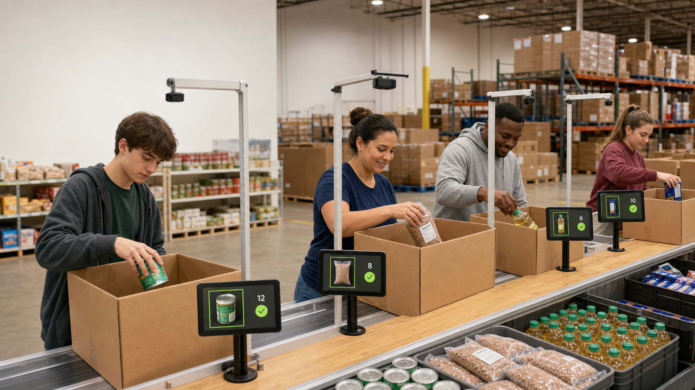

# UH HFB Hackathon - SmartPack

SmartPack is a passive computer-vision inspector for food-box packing stations. An
overhead camera watches the box, counts the item assigned to the current station,
and saves the settled count when the box leaves. It gives volunteers a second set
of eyes without adding another manual checkpoint.

> **Hackathon context:** the working prototype and presentation were assembled in
> under one hour during the University of Houston Houston Food Bank challenge. It
> earned second place. This repository preserves that rapid prototype and should
> not be interpreted as a production deployment or a validated food-safety system.



## Demo scope

The final demonstration uses two specialized YOLO object detectors in sequence:

1. `can.pt` counts canned vegetables.
2. `chili-stew.pt` counts chili/stew.

The entire camera frame is the counting area. SmartPack first learns an empty-table
reference, waits for a box to enter and settle, stabilizes the visible item count,
then records that count when the box is removed. It loads the next station model
and repeats the process.

SmartPack does **not** read expiration dates, inspect dents, identify unsafe food,
or replace a volunteer's final decision.

## Repository contents

| Path | Purpose |
| --- | --- |
| `smartpack.py` | Two-station live camera application and local CSV logging |
| `dataset_generator.py` | Synthetic one-class YOLO dataset generator |
| `train-cans.py` | Portable canned-vegetable training entry point |
| `train-chili-stew.py` | Portable chili/stew training entry point |
| `can.pt`, `chili-stew.pt` | Demo-ready specialized weights |
| `yolo26n.pt` | Base weights used by the training scripts |
| `presentation-assets/` | Presentation imagery |

The generated dataset, raw source images, CHOC frames, training runs, runtime logs,
and video recording are intentionally excluded from Git. The raw asset directory
was over 10 GB and the recording exceeded GitHub's normal 100 MB file limit.

## Installation

Python 3.10 or newer is recommended.

```bash
git clone https://github.com/playnmaker123/UH-HFB-Hackathon.git
cd UH-HFB-Hackathon
python -m venv .venv
```

Activate the environment, then install dependencies:

```bash
python -m pip install -r requirements.txt
```

CUDA is optional. Ultralytics can run on the CPU, although live inference will be
slower.

## Run the demonstration

Place the camera over an empty work surface before starting so SmartPack can
calibrate its background reference.

```bash
python smartpack.py --camera 0 --show-mask
```

Useful alternatives:

```bash
# First CUDA GPU
python smartpack.py --camera 0 --device 0

# Force CPU inference
python smartpack.py --camera 0 --device cpu

# Use another camera index and custom target quantities
python smartpack.py --camera 1 --targets 1,1
```

Press `R` to recalibrate with an empty view. Press `Q` or `Esc` to quit. Model,
dataset, output, and log paths are derived from the repository directory rather
than a developer-specific drive path.

## Recreate `dataset-items/`

The raw assets are not redistributed in this repository. They were assembled as
follows:

```text
dataset-items/
|-- boxes/                         # Real box photographs
|-- items/
|   |-- canned_vegtables/          # Real food-item photographs
|   |-- cereal/
|   |-- chili-stew/
|   `-- juice/
`-- hands/
    |-- <batch>/<frame>.png        # CHOC RGB frames
    `-- mask/mask/<batch>/<frame>.png
```

### Boxes and food items

The team photographed the real boxes and distributor-supplied food packages with
a phone from multiple angles and orientations. Backgrounds were removed from the
photos to create transparent PNG cutouts. The generator trims excess transparent
pixels, cleans small background-removal artifacts, scales each cutout, and places
it into randomized synthetic scenes.

### Hands and arms

Hand and forearm images and their segmentation masks came from the **CORSMAL
Hand-Occluded Containers (CHOC)** dataset. Download CHOC from its official Zenodo
record and retain its original license and citation requirements:

- https://zenodo.org/records/7438464

The generator pairs each CHOC RGB frame with its corresponding mask, isolates a
hand/arm foreground, and composites it near or over the target item. Hands and
boxes are visual context only; the food item is the sole YOLO class.

## Generate the synthetic datasets

With `dataset-items/` prepared in the structure above:

```bash
python dataset_generator.py --count-per-model 3000
```

The generator creates a separate one-class dataset for every item directory using
a 70/20/10 train-validation-test split. Each normal image contains one hand, one
box, and one target item. Augmentations include rotation, horizontal and vertical
flips, scale variation, hand/item overlap, brightness and contrast variation,
saturation changes, blur, and randomized background colors.

Generated data is written to `dataset/<category>/` in YOLO format. Existing
generated images are cleared before a new run; source assets are never modified.

## Train the specialized models

```bash
python train-cans.py --epochs 4 --device 0
python train-chili-stew.py --epochs 4 --device 0
```

Omit `--device` for automatic device selection or use `--device cpu`. Training
output is written under `runs/detect/` and remains untracked.

For a stronger real-world model, pretrain on the synthetic dataset and fine-tune
on separately captured and labeled images from the final camera, mounting height,
lighting, item orientations, occlusion levels, and box conditions. Keep a separate
real-image test set for honest evaluation.

## Known limitations

- The included application demonstrates only cans and chili/stew.
- Counts depend on the item being visible and sufficiently similar to training data.
- Motion blur, occlusion, autofocus changes, shadows, and scale shifts can reduce accuracy.
- Background calibration assumes the work surface is empty at startup.
- The prototype has not been validated for warehouse-wide deployment or food safety.

## Privacy and responsible use

Inference and logging run locally. SmartPack records station events and item counts,
not identities. A real deployment should position cameras tightly over boxes, avoid
faces, establish data-retention rules, measure false alerts, and keep humans in
control of every packing and food-safety decision.

## Team

- Chase Liu
- Stanley Huang
- Lucas Tang
- Rishi Kenchannavar
